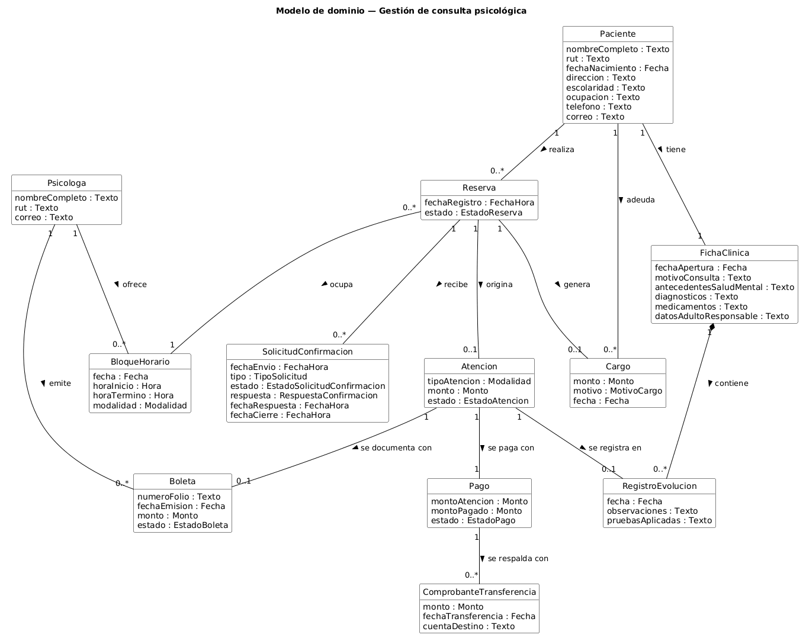

# Modelo de dominio

## Diagrama

Archivo fuente: [`./diagramas/modelo-dominio.puml`](./diagramas/modelo-dominio.puml)

## Descripción de las clases
| Clase | Qué representa en el negocio | Atributos |
|-------|------------------------------|-----------|
| Psicologa | Profesional titular de la consulta, que ofrece horas de atención y emite las boletas de honorarios. | nombreCompleto, rut, correo |
| Paciente | Persona que se atiende en la consulta y que reserva, confirma y paga sus horas. | nombreCompleto, rut, fechaNacimiento, direccion, escolaridad, ocupacion, telefono, correo |
| BloqueHorario | Espacio de tiempo de un día que la psicóloga dispone para atender. Está disponible si no tiene una reserva vigente. | fecha, horaInicio, horaTermino, modalidad (presencial / online) |
| Reserva | Compromiso de un paciente de asistir a un bloque horario. | fechaRegistro, estado (pendiente de confirmación, confirmada, sin confirmar, cancelada) |
| SolicitudConfirmacion | Mensaje enviado al paciente para que confirme o cancele su asistencia (el día anterior y en la mañana de la atención). Solo una solicitud puede estar pendiente por reserva. | fechaEnvio, tipo (aviso de víspera / recordatorio), estado (pendiente / respondida / reemplazada / vencida), respuesta (confirma / no asistirá / sin respuesta), fechaRespuesta (solo respuesta efectiva del paciente), fechaCierre (reemplazo o vencimiento) |
| Atencion | Sesión psicológica que se origina de una reserva confirmada. | tipoAtencion (presencial / online), monto, estado (programada, realizada, inasistencia, inasistencia justificada) |
| Pago | Obligación de pago de una atención y su situación. | montoAtencion, montoPagado, estado (pendiente, pagado, pago incompleto) |
| ComprobanteTransferencia | Respaldo de la transferencia que hace el paciente para pagar una atención. | monto, fechaTransferencia, cuentaDestino |
| Cargo | Cobro de $5.000 por reserva de hora cuando el paciente no confirma o no asiste sin justificación. | monto, motivo (sin confirmar / inasistencia), fecha |
| Boleta | Boleta de honorarios electrónica que respalda el cobro de una atención pagada. | numeroFolio, fechaEmision, monto, estado (en preparación, pendiente de emisión, emitida) |
| FichaClinica | Registro clínico del paciente con sus antecedentes (anamnesis). | fechaApertura, motivoConsulta, antecedentesSaludMental, diagnosticos, medicamentos, datosAdultoResponsable |
| RegistroEvolucion | Anotación clínica de la psicóloga sobre una atención realizada. | fecha, observaciones, pruebasAplicadas |

## Asociaciones
| Asociación | Clases | Multiplicidades | Justificación |
|------------|--------|-----------------|----------------|
| ofrece | Psicologa – BloqueHorario | 1 a 0..* | La psicóloga define su disponibilidad. Cada bloque horario pertenece a la única psicóloga de la consulta. |
| realiza | Paciente – Reserva | 1 a 0..* | Un paciente puede tener muchas reservas en el tiempo. Cada reserva es de un solo paciente. |
| ocupa | Reserva – BloqueHorario | 0..* a 1 | Cada reserva ocupa un bloque horario. Un bloque puede acumular reservas canceladas en su historia, pero solo una reserva vigente a la vez. |
| recibe | Reserva – SolicitudConfirmacion | 1 a 0..* | Se envía el aviso de víspera y el recordatorio de la mañana; al reemplazar el aviso por el recordatorio, la solicitud anterior queda cerrada y solo la más reciente permanece pendiente. |
| origina | Reserva – Atencion | 1 a 0..1 | Solo una reserva confirmada da origen a una atención. Una reserva cancelada no tiene atención. |
| genera | Reserva – Cargo | 1 a 0..1 | Una reserva sin confirmar o con inasistencia sin justificación genera un cargo de $5.000. |
| adeuda | Paciente – Cargo | 1 a 0..* | Los cargos por reserva de hora quedan a nombre del paciente. |
| se paga con | Atencion – Pago | 1 a 1 | Toda atención tiene un pago asociado, cuyo estado puede estar pendiente. |
| se respalda con | Pago – ComprobanteTransferencia | 1 a 0..* | El paciente envía uno o más comprobantes; con varios se completa un pago incompleto. |
| se documenta con | Atencion – Boleta | 1 a 0..1 | Solo se emite boleta cuando la atención está pagada. |
| emite | Psicologa – Boleta | 1 a 0..* | La psicóloga es la emisora de las boletas de honorarios ante el SII. |
| tiene | Paciente – FichaClinica | 1 a 1 | Cada paciente tiene una única ficha clínica. |
| contiene | FichaClinica – RegistroEvolucion | 1 a 0..* (composición) | Los registros de evolución son parte de la ficha y no existen fuera de ella. |
| se registra en | Atencion – RegistroEvolucion | 1 a 0..1 | La psicóloga registra la evolución de cada atención realizada. |

## Reglas de SolicitudConfirmacion

- **Una sola solicitud pendiente por reserva.** La base de datos debe impedir más de una fila con `estado = pendiente` para la misma reserva mediante una restricción de integridad (índice único parcial).
- **Al enviar el recordatorio**, la solicitud pendiente anterior pasa a `reemplazada` con `fechaCierre` igual a la fecha de envío del recordatorio, y la nueva solicitud se crea como `pendiente`. Ambas operaciones se ejecutan en una misma transacción.
- **Al responder el paciente**, solo se modifica la solicitud pendiente más reciente. Esta pasa a `respondida`, registra `respuesta` y `fechaRespuesta`. Las solicitudes `reemplazada` o `vencida` no admiten respuestas.
- **Sin respuesta a la hora de la atención**, la solicitud pendiente más reciente pasa a `vencida`, registra `respuesta = sin respuesta`, deja `fechaRespuesta` nula y usa `fechaCierre` con la fecha y hora de la atención. El cargo se asocia al paciente y a la reserva.
- **Fechas con significado distinto:** `fechaRespuesta` solo documenta una respuesta efectiva del paciente; `fechaCierre` documenta el reemplazo o vencimiento de una solicitud que no fue respondida.
- **Envío por correo:** cada `SolicitudConfirmacion` genera un correo con dos enlaces seguros de un solo uso (confirmar y no asistirá). El correo es el canal de notificación; no reemplaza a la solicitud ni a la respuesta registrada.
- **Reagendamiento:** al cambiar el bloque de una reserva confirmada, la reserva vuelve a `pendiente de confirmación` y se inicia un nuevo ciclo de solicitudes. Las solicitudes del ciclo anterior se conservan como historial y no admiten nuevas respuestas. El bloque anterior se libera y queda registrado en el historial de cambios.

## Entidades de soporte técnico

Estas entidades no forman parte del lenguaje del negocio, pero sostienen la entrega y la respuesta segura. Se documentan para mantener la trazabilidad con la implementación y no se incorporan al diagrama de dominio.

| Entidad de soporte | Qué representa | Atributos principales |
|---|---|---|
| CorreoPendiente | Trabajo de envío persistente asociado a una reserva, solicitud o cargo. | claveIdempotencia, tipo, destinatario, asunto, estado (pendiente / enviando / enviado / fallido / omitido / cancelado), intentos, próximoIntento, últimoError, idMensaje |
| TokenConfirmacion | Enlace de un solo uso para confirmar o informar que no se asistirá. | acción (confirmar / cancelar), hash del token, creadoEn, expiraEn, usadoEn |
| ReservaHistorial | Registro técnico de las cancelaciones y reagendamientos para conservar el bloque anterior y el motivo del cambio. | tipo (cancelación / reagendamiento), estadoAnterior, estadoNuevo, bloqueAnterior, bloqueNuevo, versiónAnterior, versiónNueva, fecha |

## Decisiones de modelado
- **Secretaria como rol, no como clase:** el negocio no registra información propia de la secretaria, por lo que no se modela como clase del dominio. En el proceso TO-BE sus tareas de coordinación (informar horarios, registrar horas y confirmar asistencia) pasan a ser realizadas por el paciente y por el sistema, por lo que tampoco aparece como actor en los casos de uso de esta entrega; solo se menciona en HU-10 para verificar que no puede acceder a la ficha clínica. Paciente y Psicologa sí son clases porque el negocio guarda datos propios de cada uno (RUT, contacto, emisión de boletas).
- **Adulto responsable como dato de la ficha:** la ficha de anamnesis registra al adulto responsable y a las personas que viven con el paciente. En esta entrega se guarda como atributo de FichaClinica (datosAdultoResponsable), ya que en el proceso TO-BE quien reserva y confirma es el Paciente.
- **Composición:** se usó solo entre FichaClinica y RegistroEvolucion, porque un registro de evolución no tiene sentido fuera de la ficha del paciente. No se usó agregación.
- **Herencia:** no se usó. La modalidad presencial u online no cambia los datos ni las reglas de la atención, por lo que se modela como atributo (modalidad, tipoAtencion).
- **Estados como atributos:** los estados de Reserva, Atencion, Pago y Boleta usan los mismos nombres que los criterios de aceptación (07) y que los diagramas de estado (11): EST-01 Reserva, EST-02 Pago y EST-03 Boleta.
- **Sistemas externos fuera del dominio:** el servicio de correo electrónico (SMTP) y el SII no son conceptos del negocio, sino sistemas con los que el sistema se integra. Aparecen como actores en los casos de uso (09) y como participantes en los diagramas de secuencia (10). La cola de correos y los tokens son entidades de soporte técnico, no del dominio.
