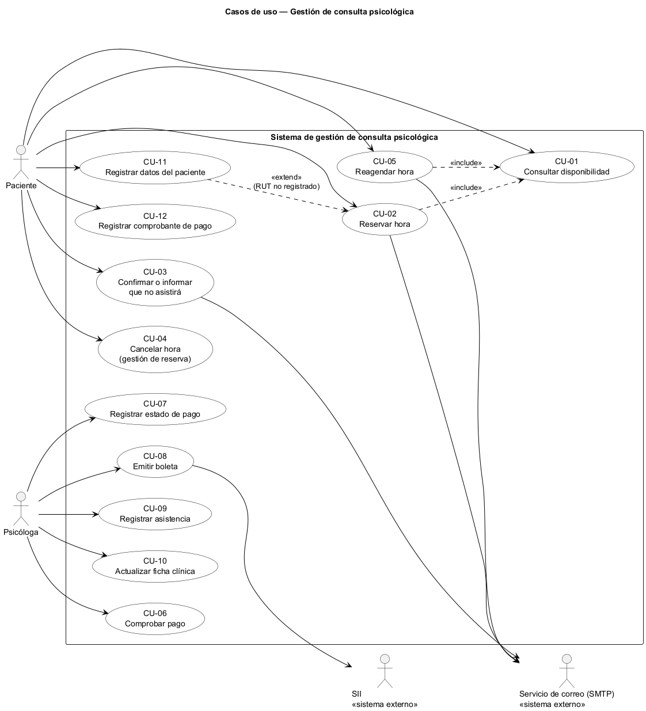

# Casos de uso

## Actores
| Actor | Tipo (humano / sistema externo) | Descripción |
|-------|----------------------------------|-------------|
| Paciente | Humano | Persona que consulta la disponibilidad, reserva, confirma, cancela y reagenda sus horas de atención. |
| Psicóloga | Humano | Profesional que comprueba y registra los pagos, emite las boletas, registra la asistencia y actualiza la ficha clínica de sus pacientes. |
| Servicio de correo electrónico (SMTP) | Sistema externo | Servicio que entrega al paciente los avisos de reserva, las solicitudes de confirmación, los recordatorios y los avisos de cargo por correo electrónico. En pruebas se reemplaza por un servidor SMTP falso local. |
| SII | Sistema externo | Servicio de Impuestos Internos, que recibe y registra las boletas de honorarios electrónicas emitidas por la psicóloga. |

## Diagrama de casos de uso

Archivo fuente: [`./diagramas/casos-de-uso.puml`](./diagramas/casos-de-uso.puml)

## Casos de uso y su origen
| ID | Caso de uso (objetivo del actor) | Actor principal | Historia de origen |
|----|-----------------------------------|-----------------|---------------------|
| CU-01 | Consultar disponibilidad | Paciente | [HU-01](./04-historias-usuario.md#hu-01--consultar-disponibilidad) |
| CU-02 | Reservar hora | Paciente | [HU-02](./04-historias-usuario.md#hu-02--reservar-una-hora) |
| CU-03 | Confirmar o informar que no asistirá (plataforma o enlace seguro del correo) | Paciente | [HU-03](./04-historias-usuario.md#hu-03--confirmar-o-cancelar-una-hora) |
| CU-04 | Cancelar hora desde la gestión de la reserva | Paciente | [HU-04](./04-historias-usuario.md#hu-04--reagendar-o-cancelar-una-hora) |
| CU-05 | Reagendar hora | Paciente | [HU-04](./04-historias-usuario.md#hu-04--reagendar-o-cancelar-una-hora) |
| CU-06 | Comprobar pago | Psicóloga | [HU-05](./04-historias-usuario.md#hu-05--comprobar-el-pago) |
| CU-07 | Registrar estado de pago | Psicóloga | [HU-06](./04-historias-usuario.md#hu-06--registrar-el-estado-de-pago) |
| CU-08 | Emitir boleta | Psicóloga | [HU-07](./04-historias-usuario.md#hu-07--emitir-boleta) |
| CU-09 | Registrar asistencia | Psicóloga | [HU-08](./04-historias-usuario.md#hu-08--registrar-asistencia-e-inasistencia) |
| CU-10 | Actualizar ficha clínica | Psicóloga | [HU-09](./04-historias-usuario.md#hu-09--actualizar-ficha-clínica) |
| CU-11 | Registrar datos del paciente | Paciente | [HU-02A](./04-historias-usuario.md#hu-02a--registrar-datos-del-paciente) |
| CU-12 | Registrar comprobante de pago | Paciente | [HU-05A](./04-historias-usuario.md#hu-05a--registrar-la-atención-y-el-comprobante-de-pago) |

## Relaciones entre casos de uso
| Relación | Casos de uso | Justificación |
|----------|--------------|---------------|
| include | CU-02 Reservar hora → CU-01 Consultar disponibilidad | Para reservar, el paciente siempre necesita conocer los bloques horarios disponibles. |
| include | CU-05 Reagendar hora → CU-01 Consultar disponibilidad | Para reagendar, el paciente siempre necesita conocer las alternativas disponibles. |
| extend | CU-11 Registrar datos del paciente → CU-02 Reservar hora | Cuando el paciente reserva y su RUT no está registrado, se ejecuta opcionalmente el registro de sus datos; al finalizar, se retoma la reserva del bloque seleccionado. |

**CU-03 y CU-04 se mantienen separados.** CU-03 cubre ambas respuestas del paciente a la solicitud de confirmación: mantener la hora o informar que no asistirá, lo que cancela la reserva y libera el bloque. CU-04 cubre la cancelación que el paciente inicia por sí sola desde la gestión de su reserva, sin depender de una solicitud de confirmación. Por eso no existe una relación `extend` entre ambos.
