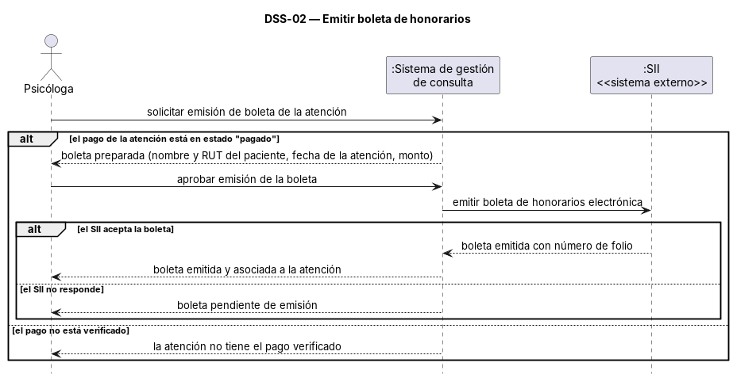
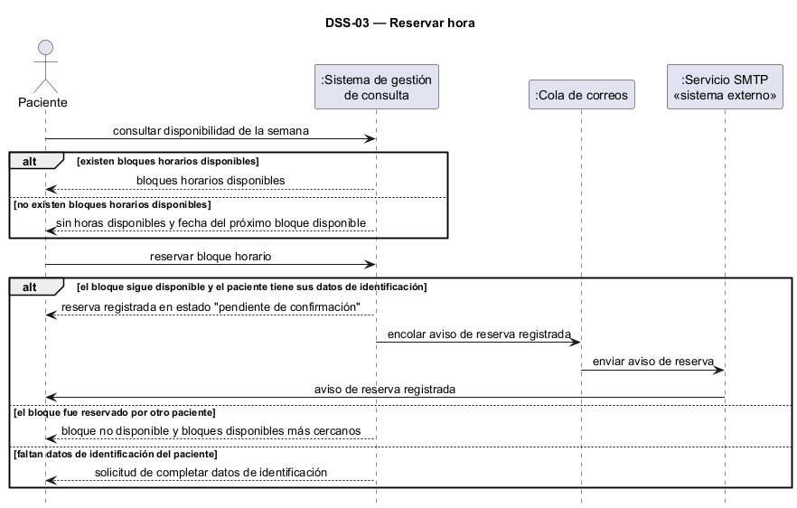

# Diagramas de secuencia de sistema

## DSS-01 — Confirmar asistencia
- Caso de uso: [CU-03](./09-casos-de-uso.md)
- Historia: [HU-03](./04-historias-usuario.md#hu-03--confirmar-o-cancelar-una-hora)
- Sistemas externos que participan: Servicio de mensajería

Archivo fuente: [`./diagramas/dss-01.puml`](./diagramas/dss-01.puml)

Variantes representadas:
- **alt — el paciente confirma su asistencia:** la reserva queda confirmada.
- **alt — el paciente responde que no asistirá:** la reserva queda cancelada y el bloque horario se libera (extensión CU-04).
- **alt — el paciente no responde:** se envía el recordatorio en la mañana de la atención.
- **opt — el paciente no responde hasta la hora de la atención:** la reserva queda sin confirmar, se registra el cargo de $5.000 y se avisa al paciente.

## DSS-02 — Emitir boleta de honorarios
- Caso de uso: [CU-08](./09-casos-de-uso.md)
- Historia: [HU-08](./04-historias-usuario.md#hu-08--emitir-boleta)
- Sistemas externos que participan: SII

Archivo fuente: [`./diagramas/dss-02.puml`](./diagramas/dss-02.puml)

Variantes representadas:
- **alt — el pago de la atención está en estado "pagado":** el sistema prepara la boleta y, con la aprobación de la psicóloga, la envía al SII.
- **alt anidado — el SII acepta la boleta:** la boleta queda emitida con su número de folio y asociada a la atención.
- **alt anidado — el SII no responde:** la boleta queda pendiente de emisión.
- **alt — el pago no está verificado:** el sistema no prepara la boleta e informa el motivo.

## DSS-03 — Reservar hora
- Caso de uso: [CU-02](./09-casos-de-uso.md) (incluye [CU-01](./09-casos-de-uso.md))
- Historia: [HU-02](./04-historias-usuario.md#hu-02--reservar-una-hora) (y [HU-01](./04-historias-usuario.md#hu-01--consultar-disponibilidad))
- Sistemas externos que participan: Servicio de mensajería

Archivo fuente: [`./diagramas/dss-03.puml`](./diagramas/dss-03.puml)

Variantes representadas:
- **alt — existen o no existen bloques horarios disponibles** al consultar la semana.
- **alt — el bloque sigue disponible y el paciente tiene sus datos de identificación:** la reserva queda pendiente de confirmación y se envía el aviso de reserva.
- **alt — el bloque fue reservado por otro paciente:** se rechaza la reserva y se informan los bloques más cercanos.
- **alt — faltan datos de identificación del paciente:** no se registra la reserva y se solicita completar los datos.
