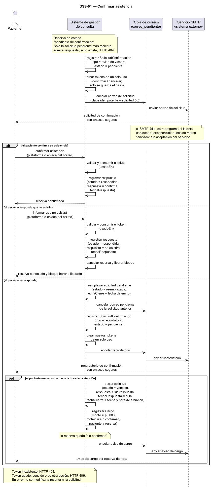
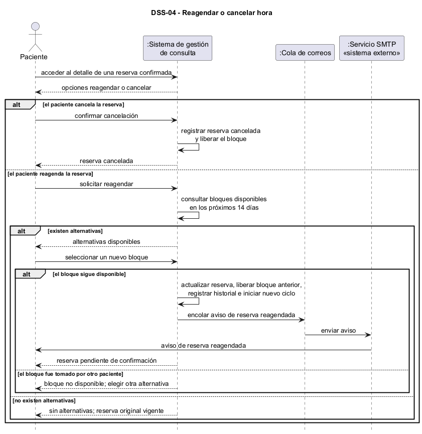

# Diagramas de secuencia de sistema

## DSS-01 — Confirmar asistencia
- Caso de uso: [CU-03](./09-casos-de-uso.md)
- Historia: [HU-03](./04-historias-usuario.md#hu-03--confirmar-o-cancelar-una-hora)
- Sistemas externos que participan: Servicio de correo electrónico (SMTP)

Archivo fuente: [`./diagramas/dss-01.puml`](./diagramas/dss-01.puml)

Variantes representadas:
- **Programación automática:** en la víspera, el planificador registra la solicitud, crea dos tokens de un solo uso (solo guarda el hash) y encola el correo. En la mañana, reemplaza la solicitud anterior, cancela su correo pendiente y encola el recordatorio.
- **Entrega por cola:** el planificador reclama el correo, lo envía por SMTP y registra `Message-ID` y fecha. Si el servidor falla, reprograma el intento con espera exponencial; si las credenciales se rechazan, lo marca fallido; si no hay correo del paciente, queda omitido.
- **alt — el paciente confirma su asistencia:** desde la plataforma o el enlace seguro, el token se consume, la solicitud pendiente más reciente queda respondida y la reserva queda confirmada.
- **alt — el paciente responde que no asistirá:** la solicitud pendiente más reciente queda respondida, la reserva queda cancelada y el bloque horario se libera (extensión CU-04).
- **opt — el paciente no responde hasta la hora de la atención:** la solicitud queda vencida con respuesta «sin respuesta» y fecha de cierre, sin fecha de respuesta del paciente; la reserva queda sin confirmar, se registra el cargo de $5.000 asociado al paciente y a la reserva, y se encola el aviso de cargo por correo.
- **Error:** si no existe una solicitud pendiente, o la solicitud más reciente ya está respondida, reemplazada o vencida, el sistema rechaza la respuesta con HTTP 409 sin modificar datos. Un token inexistente responde 404 y uno usado, vencido o de otra acción responde 409.

## DSS-02 — Emitir boleta de honorarios
- Caso de uso: [CU-08](./09-casos-de-uso.md)
- Historia: [HU-08](./04-historias-usuario.md#hu-08--emitir-boleta)
- Sistemas externos que participan: SII

Archivo fuente: [`./diagramas/dss-02.puml`](./diagramas/dss-02.puml)

Variantes representadas:
- **alt — el pago de la atención está en estado "pagado":** el sistema prepara la boleta y, con la aprobación de la psicóloga, la envía al SII.
- **alt anidado — el SII acepta la boleta:** la boleta queda emitida con su número de folio y asociada a la atención.
- **alt anidado — el SII no responde:** la boleta queda pendiente de emisión.
- **alt — el pago no está verificado:** el sistema no prepara la boleta e informa el motivo.

## DSS-03 — Reservar hora
- Caso de uso: [CU-02](./09-casos-de-uso.md) (incluye [CU-01](./09-casos-de-uso.md))
- Historia: [HU-02](./04-historias-usuario.md#hu-02--reservar-una-hora) (y [HU-01](./04-historias-usuario.md#hu-01--consultar-disponibilidad))
- Sistemas externos que participan: Servicio de correo electrónico (SMTP)

Archivo fuente: [`./diagramas/dss-03.puml`](./diagramas/dss-03.puml)

Variantes representadas:
- **alt — existen o no existen bloques horarios disponibles** al consultar la semana.
- **alt — el bloque sigue disponible y el paciente tiene sus datos de identificación:** la reserva queda pendiente de confirmación y se encola el aviso de reserva por correo electrónico.
- **alt — el bloque fue reservado por otro paciente:** se rechaza la reserva y se informan los bloques más cercanos.
- **alt — faltan datos de identificación del paciente:** no se registra la reserva y se solicita completar los datos.

## DSS-04 - Reagendar o cancelar hora
- Casos de uso: [CU-04](./09-casos-de-uso.md) y [CU-05](./09-casos-de-uso.md)
- Historia: [HU-04](./04-historias-usuario.md#hu-04--reagendar-o-cancelar-una-hora)
- Sistemas externos que participan: Servicio de correo electrónico (SMTP)

Archivo fuente: [`./diagramas/dss-04.puml`](./diagramas/dss-04.puml)

Variantes representadas:
- **Cancelación:** el paciente confirma la cancelación; la reserva queda cancelada, el bloque se libera y no se crea un nuevo ciclo de confirmación.
- **Reagendamiento con alternativas:** el sistema consulta los bloques libres de los próximos 14 días y los presenta al paciente; la reserva original se mantiene vigente hasta que se elige una alternativa.
- **Nuevo horario disponible:** la reserva se actualiza al nuevo bloque, el bloque anterior se libera, se registra el cambio en el historial y se reinicia el ciclo de solicitudes de confirmación; se encola el aviso de reserva reagendada.
- **Nuevo horario tomado:** el sistema rechaza el cambio y la reserva original queda sin modificaciones.
- **Sin alternativas:** el sistema informa que no hay horarios disponibles y conserva la reserva original.
