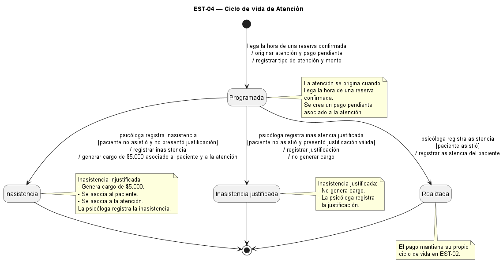

# Diagramas de estado

## EST-01 — Ciclo de vida de Reserva

- Clase del dominio: [Reserva](./08-modelo-dominio.md)
- Diagramas de secuencia relacionados: [DSS-01](./10-diagramas-secuencia.md), [DSS-03](./10-diagramas-secuencia.md), [DSS-04](./10-diagramas-secuencia.md)

Archivo fuente: [`./diagramas/est-01.puml`](./diagramas/est-01.puml)

### Tabla de transiciones

| Estado origen | Evento | Guarda | Acción | Estado destino |
|---|---|---|---|---|
| (inicial) | paciente confirma el bloque horario seleccionado | bloque disponible y datos del paciente registrados | registrar reserva, ocupar bloque y encolar el aviso de reserva por correo | Pendiente de confirmación |
| Pendiente de confirmación | llega la víspera de la atención | — | crear la solicitud de confirmación pendiente, sus tokens y encolar el correo | Pendiente de confirmación (transición interna) |
| Pendiente de confirmación | llega la mañana de la atención | sin respuesta | reemplazar la solicitud pendiente anterior, cancelar su correo y encolar el recordatorio | Pendiente de confirmación (transición interna) |
| Pendiente de confirmación | paciente confirma asistencia | existe una única solicitud pendiente y es la más reciente; token válido si viene del correo | consumir el token, registrar respuesta y fecha de respuesta; marcar la solicitud como respondida | Confirmada |
| Pendiente de confirmación | paciente informa que no asistirá | existe una única solicitud pendiente y es la más reciente; token válido si viene del correo | consumir el token, registrar respuesta y fecha de respuesta; marcar la solicitud como respondida; registrar cargo de $5.000 asociado al paciente y a la reserva; liberar bloque y encolar aviso del cargo | Cancelada |
| Pendiente de confirmación | llega la hora de la atención | sin respuesta y existe una solicitud pendiente | marcar la solicitud como vencida con respuesta «sin respuesta» y registrar fecha de cierre; generar el cargo de $5.000 y encolar su aviso solo si SMTP aceptó una solicitud del ciclo vigente antes de esa hora | Sin confirmar |
| Confirmada | paciente confirma la cancelación | cancelación solicitada y confirmada por el paciente | registrar cargo de $5.000 asociado al paciente y a la reserva; liberar bloque y encolar aviso del cargo | Cancelada |
| Pendiente de confirmación | psicóloga cancela la hora | cancelación realizada por la psicóloga | liberar bloque y conservar historial; no generar cargo | Cancelada |
| Confirmada | psicóloga cancela la hora | cancelación realizada por la psicóloga | liberar bloque y conservar historial; no generar cargo | Cancelada |
| Confirmada | paciente reagenda | nuevo bloque disponible | liberar bloque anterior, ocupar nuevo bloque, registrar historial e iniciar nuevo ciclo de confirmación; no generar cargo | Pendiente de confirmación |
| Confirmada | llega la hora de la atención | — | originar atención y pago; registrar el cierre de la reserva | Finalizada |
| Cancelada | — | — | — | (final) |
| Sin confirmar | — | — | — | (final) |
| Finalizada | — | — | — | (final) |

**Guarda de respuesta:** si no existe una solicitud enviada y pendiente de respuesta, o la solicitud más reciente no está en estado pendiente, el sistema rechaza la operación con HTTP 409 y no modifica la reserva, las solicitudes ni el cargo.

El plazo de respuesta termina al inicio del bloque. El servidor rechaza las respuestas desde ese instante aunque el planificador todavía no haya procesado el vencimiento.

**Regla de vigencia:** una reserva se considera vigente mientras esté en estado Pendiente de confirmación o Confirmada. Las reservas Canceladas, Sin confirmar o Finalizadas no bloquean el bloque horario. Una reserva Finalizada no admite reagendamiento ni cancelación.

**Disponibilidad del bloque:** además de la vigencia, el inicio debe ser futuro y el bloque completo debe quedar entre las 09:00 y las 19:00 de lunes a sábado en la zona horaria configurada. Un bloque cuya reserva se finalizó al llegar la hora ya no se puede reservar.

**Regla de cargos:** cuando el paciente confirma la cancelación de una reserva, se genera un cargo de $5.000 asociado al paciente y a la reserva, independientemente de la anticipación o del motivo de la cancelación. La cancelación realizada por la psicóloga no genera cargos. La falta de confirmación hasta la hora de atención genera un cargo de $5.000 únicamente si SMTP aceptó antes una solicitud de confirmación del ciclo vigente.

**Reagendamiento:** al pasar de Confirmada a Pendiente de confirmación se conserva el bloque anterior en el historial de cambios y se inicia un nuevo ciclo de solicitudes; las solicitudes del ciclo anterior permanecen como registro histórico y no admiten nuevas respuestas. El reagendamiento no genera un cargo.

### Estados de SolicitudConfirmacion

| Estado | Significado | Regla |
|--------|-------------|-------|
| pendiente | Solicitud habilitada para recibir la respuesta del paciente. | Debe existir como máximo una por reserva. |
| respondida | El paciente confirmó o informó que no asistirá. | Tiene `respuesta` y `fechaRespuesta`; su `fechaCierre` es nula. |
| reemplazada | Una solicitud anterior fue sustituida por el recordatorio. | No admite respuestas; tiene `fechaCierre` y no tiene `fechaRespuesta`. |
| vencida | Llegó la hora de la atención sin respuesta. | Conserva `respuesta = sin respuesta`; tiene `fechaCierre` y no tiene `fechaRespuesta`. |

`fechaRespuesta` documenta solo una respuesta efectiva del paciente. `fechaCierre` documenta el reemplazo o vencimiento de una solicitud que no fue respondida. Ambas fechas no son intercambiables.

### Estados de CorreoPendiente

| Estado | Significado | Regla |
|--------|-------------|-------|
| pendiente | El correo espera ser reclamado por el planificador o aguarda un reintento. | Tiene `proximoIntento`; si SMTP no está configurado se mantiene aquí con el motivo. |
| enviando | Un worker reclamó el correo y está intentando enviarlo. | Si supera el timeout, vuelve a `pendiente` al reiniciar. |
| enviado | El servidor SMTP aceptó el mensaje. | Requiere `destinatario`, `enviadoEn` e `idMensaje`; no se vuelve a reclamar. |
| fallido | Se agotaron los intentos o las credenciales fueron rechazadas. | No se reintenta automáticamente. |
| omitido | El paciente no tiene correo registrado. | No se envía y nunca se marca `enviado`. |
| cancelado | La solicitud fue reemplazada por el recordatorio. | No se envía. |

### Tokens de confirmación

Los enlaces de correo usan un token por acción (`confirmar` / `cancelar`). La base guarda solo su hash, la expiración (inicio de la atención) y la marca de uso. Un token usado, vencido, inexistente o de la acción contraria no permite registrar una respuesta.

## EST-02 — Ciclo de vida de Pago

- Clase del dominio: [Pago](./08-modelo-dominio.md)
- Diagramas de secuencia relacionados: ninguno.

Archivo fuente: [`./diagramas/est-02.puml`](./diagramas/est-02.puml)

### Tabla de transiciones

| Estado origen | Evento | Guarda | Acción | Estado destino |
|---------------|--------|--------|--------|----------------|
| (inicial) | se origina la atención | — | registrar monto de la atención | Pendiente |
| Pendiente | psicóloga verifica comprobante | monto comprobado = monto de la atención | registrar monto pagado | Pagado |
| Pendiente | psicóloga verifica comprobante | monto comprobado < monto de la atención | informar diferencia pendiente | Pago incompleto |
| Pago incompleto | psicóloga verifica nuevo comprobante | total comprobado = monto de la atención | registrar monto pagado | Pagado |
| Pago incompleto | psicóloga verifica nuevo comprobante | total comprobado < monto de la atención | actualizar diferencia pendiente | Pago incompleto (transición interna) |
| Pagado | — | — | — | (final) |

**Cargo (HU-06):** un Cargo de $5.000 sigue el mismo ciclo de vida que el Pago: nace en **Pendiente**; cuando la psicóloga verifica comprobantes pasa a **Pagado** si el total comprobado iguala $5.000 o a **Pago incompleto** si es menor (transición interna hasta completarlo); **Pagado** es final.

**Nota:** la emisión de la boleta se modela en EST-03 y no cambia el estado del Pago. Un pago puede quedar Pagado aunque la boleta siga pendiente de emisión.

## EST-03 — Ciclo de vida de Boleta

Modelo previsto para HU-07, pendiente de integración externa por alcance.

- Clase del dominio: [Boleta](./08-modelo-dominio.md)
- Diagramas de secuencia relacionados: [DSS-02](./10-diagramas-secuencia.md)

Archivo fuente: [`./diagramas/est-03.puml`](./diagramas/est-03.puml)

### Tabla de transiciones

| Estado origen | Evento | Guarda | Acción | Estado destino |
|---------------|--------|--------|--------|----------------|
| (inicial) | psicóloga solicita emisión de boleta | — | preparar boleta con datos del paciente y de la atención | En preparación |
| En preparación | SII acepta la boleta | — | asociar número de folio a la atención | Emitida |
| En preparación | SII no responde | — | agregar a boletas pendientes | Pendiente de emisión |
| Pendiente de emisión | psicóloga reintenta la emisión | — | — | En preparación |
| Emitida | — | — | — | (final) |

## EST-04 — Ciclo de vida de Atención

- Clase del dominio: [Atencion](./08-modelo-dominio.md)
- Historia de usuario relacionada: HU-08
- Diagramas de secuencia relacionados: [DSS-02](./10-diagramas-secuencia.md)

Archivo fuente: [`./diagramas/est-04.puml`](./diagramas/est-04.puml)

### Tabla de transiciones

| Estado origen | Evento | Guarda | Acción | Estado destino |
|---------------|--------|--------|--------|----------------|
| (inicial) | se origina la atención desde una reserva confirmada | llegó la hora de la atención | registrar tipo de atención y monto; originar pago pendiente | Programada |
| Programada | psicóloga registra asistencia | paciente asistió a la atención | registrar asistencia | Realizada |
| Programada | psicóloga registra inasistencia sin justificación | paciente no asistió y no presentó justificación | registrar inasistencia y generar cargo de $5.000 asociado al paciente y a la atención | Inasistencia |
| Programada | psicóloga registra inasistencia justificada | paciente no asistió y presentó una justificación válida | registrar inasistencia justificada; no generar cargo | Inasistencia justificada |
| Realizada | — | — | — | (final) |
| Inasistencia | — | — | — | (final) |
| Inasistencia justificada | — | — | — | (final) |

### Reglas de Atención

- **Registro de asistencia:** la psicóloga es responsable de registrar si el paciente asistió o no a la atención.
- **Atención realizada:** cuando el paciente asiste, la atención pasa al estado Realizada.
- **Inasistencia injustificada:** cuando el paciente no asiste y no presenta una justificación válida, se registra un cargo de $5.000 asociado al paciente y a la atención.
- **Inasistencia justificada:** cuando la psicóloga registra una justificación válida, la atención pasa a Inasistencia justificada y no genera cargo.
- **Cancelación por parte de la psicóloga:** no genera cargos para el paciente.
- **Pago:** el registro de asistencia no modifica automáticamente el estado del pago. El pago conserva su propio ciclo de vida definido en EST-02.
