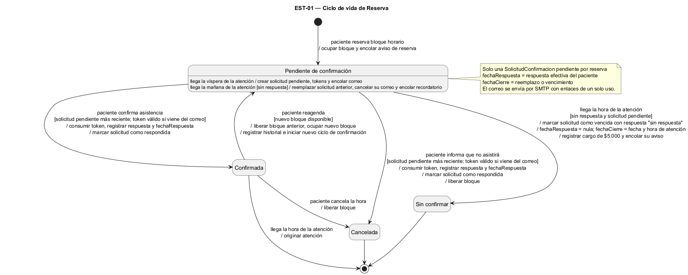

# Diagramas de estado

## EST-01 — Ciclo de vida de Reserva
- Clase del dominio: [Reserva](./08-modelo-dominio.md)
- Diagramas de secuencia relacionados: [DSS-01](./10-diagramas-secuencia.md), [DSS-03](./10-diagramas-secuencia.md)

Archivo fuente: [`./diagramas/est-01.puml`](./diagramas/est-01.puml)

### Tabla de transiciones
| Estado origen | Evento | Guarda | Acción | Estado destino |
|---------------|--------|--------|--------|----------------|
| (inicial) | paciente reserva bloque horario | — | ocupar bloque y enviar aviso de reserva | Pendiente de confirmación |
| Pendiente de confirmación | llega la víspera de la atención | — | enviar solicitud de confirmación | Pendiente de confirmación (transición interna) |
| Pendiente de confirmación | llega la mañana de la atención | sin respuesta | enviar recordatorio | Pendiente de confirmación (transición interna) |
| Pendiente de confirmación | paciente confirma asistencia | — | — | Confirmada |
| Pendiente de confirmación | paciente informa que no asistirá | — | liberar bloque | Cancelada |
| Pendiente de confirmación | llega la hora de la atención | sin respuesta | registrar cargo de $5.000 | Sin confirmar |
| Confirmada | paciente cancela la hora | — | liberar bloque | Cancelada |
| Confirmada | paciente reagenda | nuevo bloque disponible | liberar bloque anterior y ocupar nuevo bloque | Pendiente de confirmación |
| Confirmada | llega la hora de la atención | — | originar atención | (final) |
| Cancelada | — | — | — | (final) |
| Sin confirmar | — | — | — | (final) |

**Regla de vigencia:** una reserva se considera vigente mientras esté en estado Pendiente de confirmación o Confirmada. Las reservas Canceladas o Sin confirmar no bloquean el bloque horario.

## EST-02 — Ciclo de vida de Pago
- Clase del dominio: [Pago](./08-modelo-dominio.md)
- Diagramas de secuencia relacionados: [DSS-02](./10-diagramas-secuencia.md)

Archivo fuente: [`./diagramas/est-02.puml`](./diagramas/est-02.puml)

### Tabla de transiciones
| Estado origen | Evento | Guarda | Acción | Estado destino |
|---------------|--------|--------|--------|----------------|
| (inicial) | se origina la atención | — | registrar monto de la atención | Pendiente |
| Pendiente | psicóloga verifica comprobante | monto comprobado = monto de la atención | registrar monto pagado | Pagado |
| Pendiente | psicóloga verifica comprobante | monto comprobado < monto de la atención | informar diferencia pendiente | Pago incompleto |
| Pago incompleto | psicóloga verifica nuevo comprobante | total comprobado = monto de la atención | registrar monto pagado | Pagado |
| Pago incompleto | psicóloga verifica nuevo comprobante | total comprobado < monto de la atención | actualizar diferencia pendiente | Pago incompleto (transición interna) |
| Pagado | boleta emitida | — | — | (final) |

## EST-03 — Ciclo de vida de Boleta
- Clase del dominio: [Boleta](./08-modelo-dominio.md)
- Diagramas de secuencia relacionados: [DSS-02](./10-diagramas-secuencia.md)

Archivo fuente: [`./diagramas/est-03.puml`](./diagramas/est-03.puml)

### Tabla de transiciones
| Estado origen | Evento | Guarda | Acción | Estado destino |
|---------------|--------|--------|--------|----------------|
| (inicial) | psicóloga solicita emisión de boleta | — | preparar boleta con datos del paciente y de la atención | En preparación |
| En preparación | SII acepta la boleta | — | asociar número de folio a la atención | Emitida |
| En preparación | SII no responde | — | agregar a boletas pendientes | Pendiente de emisión |
| Pendiente de emisión | psicóloga reintenta la emisión | — | — | En preparación |
| Emitida | — | — | — | (final) |
