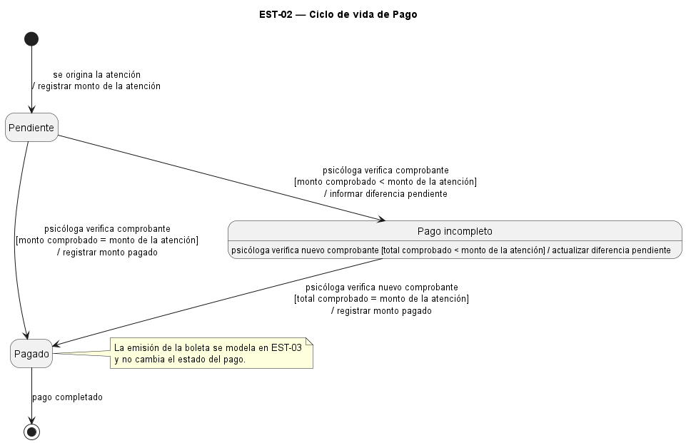
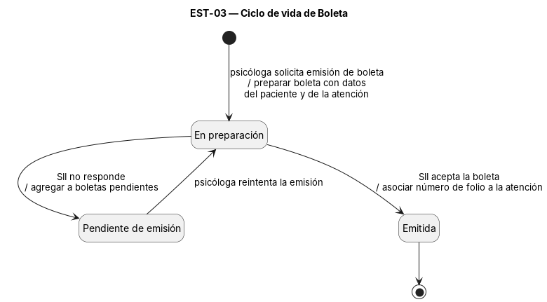

# Diagramas de estado

## EST-01 — Ciclo de vida de Reserva
- Clase del dominio: [Reserva](./08-modelo-dominio.md)
- Diagramas de secuencia relacionados: [DSS-01](./10-diagramas-secuencia.md), [DSS-03](./10-diagramas-secuencia.md), [DSS-04](./10-diagramas-secuencia.md)

Archivo fuente: [`./diagramas/est-01.puml`](./diagramas/est-01.puml)

### Tabla de transiciones
| Estado origen | Evento | Guarda | Acción | Estado destino |
|---------------|--------|--------|--------|----------------|
| (inicial) | paciente reserva bloque horario | — | ocupar bloque y encolar el aviso de reserva por correo | Pendiente de confirmación |
| Pendiente de confirmación | llega la víspera de la atención | — | crear la solicitud de confirmación pendiente, sus tokens y encolar el correo | Pendiente de confirmación (transición interna) |
| Pendiente de confirmación | llega la mañana de la atención | sin respuesta | reemplazar la solicitud pendiente anterior, cancelar su correo y encolar el recordatorio | Pendiente de confirmación (transición interna) |
| Pendiente de confirmación | paciente confirma asistencia | existe una única solicitud pendiente y es la más reciente; token válido si viene del correo | consumir el token, registrar respuesta y fecha de respuesta; marcar la solicitud como respondida | Confirmada |
| Pendiente de confirmación | paciente informa que no asistirá | existe una única solicitud pendiente y es la más reciente; token válido si viene del correo | consumir el token, registrar respuesta y fecha de respuesta; marcar la solicitud como respondida; liberar bloque | Cancelada |
| Pendiente de confirmación | llega la hora de la atención | sin respuesta y existe una solicitud pendiente | marcar la solicitud como vencida, con respuesta «sin respuesta» y fecha de cierre; registrar cargo de $5.000 y encolar su aviso | Sin confirmar |
| Confirmada | paciente cancela la hora | — | liberar bloque | Cancelada |
| Confirmada | paciente reagenda | nuevo bloque disponible | liberar bloque anterior, ocupar nuevo bloque, registrar historial e iniciar nuevo ciclo de confirmación | Pendiente de confirmación |
| Confirmada | llega la hora de la atención | — | originar atención | (final) |
| Cancelada | — | — | — | (final) |
| Sin confirmar | — | — | — | (final) |

**Guarda de respuesta:** si no existe una solicitud enviada y pendiente de respuesta, o la solicitud más reciente no está en estado pendiente, el sistema rechaza la operación con HTTP 409 y no modifica la reserva, las solicitudes ni el cargo.

**Regla de vigencia:** una reserva se considera vigente mientras esté en estado Pendiente de confirmación o Confirmada. Las reservas Canceladas o Sin confirmar no bloquean el bloque horario.

**Reagendamiento:** al pasar de Confirmada a Pendiente de confirmación se conserva el bloque anterior en el historial de cambios y se inicia un nuevo ciclo de solicitudes; las solicitudes del ciclo anterior permanecen como registro histórico y no admiten nuevas respuestas.

### Estados de SolicitudConfirmacion
| Estado | Significado | Regla |
|--------|-------------|-------|
| pendiente | Solicitud habilitada para recibir la respuesta del paciente. | Debe existir como máximo una por reserva. |
| respondida | El paciente confirmó o informó que no asistirá. | Tiene `respuesta` y `fechaRespuesta`; su `fechaCierre` es nula. |
| reemplazada | Una solicitud anterior fue sustituida por el recordatorio. | No admite respuestas; tiene `fechaCierre` y no tiene `fechaRespuesta`. |
| vencida | Llegó la hora de la atención sin respuesta. | Conserva `respuesta = sin respuesta`; tiene `fechaCierre` y no tiene `fechaRespuesta`. |

`fechaRespuesta` documenta solo una respuesta efectiva del paciente. `fechaCierre` documenta el reemplazo o vencimiento de una solicitud que no fue respondida. Ambas fechas no son intercambiables.

### Estados de CorreoPendiente
| Estado | Significado | Regla |
|--------|-------------|-------|
| pendiente | El correo espera ser reclamado por el planificador o aguarda un reintento. | Tiene `proximoIntento`; si SMTP no está configurado se mantiene aquí con el motivo. |
| enviando | Un worker reclamó el correo y está intentando enviarlo. | Si supera el timeout, vuelve a `pendiente` al reiniciar. |
| enviado | El servidor SMTP aceptó el mensaje. | Requiere `destinatario`, `enviadoEn` e `idMensaje`; no se vuelve a reclamar. |
| fallido | Se agotaron los intentos o las credenciales fueron rechazadas. | No se reintenta automáticamente. |
| omitido | El paciente no tiene correo registrado. | No se envía y nunca se marca `enviado`. |
| cancelado | La solicitud fue reemplazada por el recordatorio. | No se envía. |

### Tokens de confirmación
Los enlaces de correo usan un token por acción (`confirmar` / `cancelar`). La base guarda solo su hash, la expiración (inicio de la atención) y la marca de uso. Un token usado, vencido, inexistente o de la acción contraria no permite registrar una respuesta.

## EST-02 — Ciclo de vida de Pago
- Clase del dominio: [Pago](./08-modelo-dominio.md)
- Diagramas de secuencia relacionados: [DSS-02](./10-diagramas-secuencia.md)

Archivo fuente: [`./diagramas/est-02.puml`](./diagramas/est-02.puml)

### Tabla de transiciones
| Estado origen | Evento | Guarda | Acción | Estado destino |
|---------------|--------|--------|--------|----------------|
| (inicial) | se origina la atención | — | registrar monto de la atención | Pendiente |
| Pendiente | psicóloga verifica comprobante | monto comprobado = monto de la atención | registrar monto pagado | Pagado |
| Pendiente | psicóloga verifica comprobante | monto comprobado < monto de la atención | informar diferencia pendiente | Pago incompleto |
| Pago incompleto | psicóloga verifica nuevo comprobante | total comprobado = monto de la atención | registrar monto pagado | Pagado |
| Pago incompleto | psicóloga verifica nuevo comprobante | total comprobado < monto de la atención | actualizar diferencia pendiente | Pago incompleto (transición interna) |
| Pagado | boleta emitida | — | — | (final) |

## EST-03 — Ciclo de vida de Boleta
- Clase del dominio: [Boleta](./08-modelo-dominio.md)
- Diagramas de secuencia relacionados: [DSS-02](./10-diagramas-secuencia.md)

Archivo fuente: [`./diagramas/est-03.puml`](./diagramas/est-03.puml)

### Tabla de transiciones
| Estado origen | Evento | Guarda | Acción | Estado destino |
|---------------|--------|--------|--------|----------------|
| (inicial) | psicóloga solicita emisión de boleta | — | preparar boleta con datos del paciente y de la atención | En preparación |
| En preparación | SII acepta la boleta | — | asociar número de folio a la atención | Emitida |
| En preparación | SII no responde | — | agregar a boletas pendientes | Pendiente de emisión |
| Pendiente de emisión | psicóloga reintenta la emisión | — | — | En preparación |
| Emitida | — | — | — | (final) |
